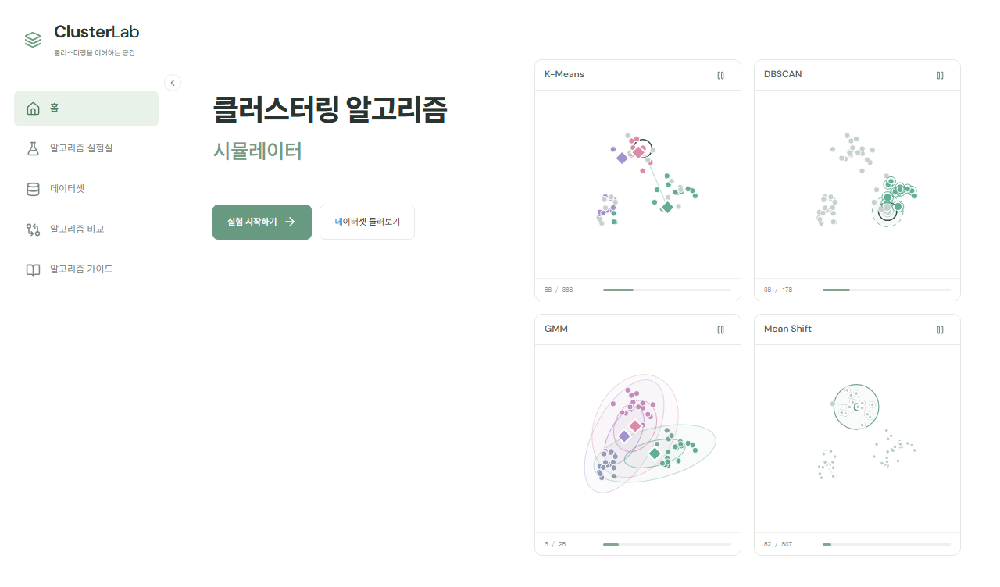
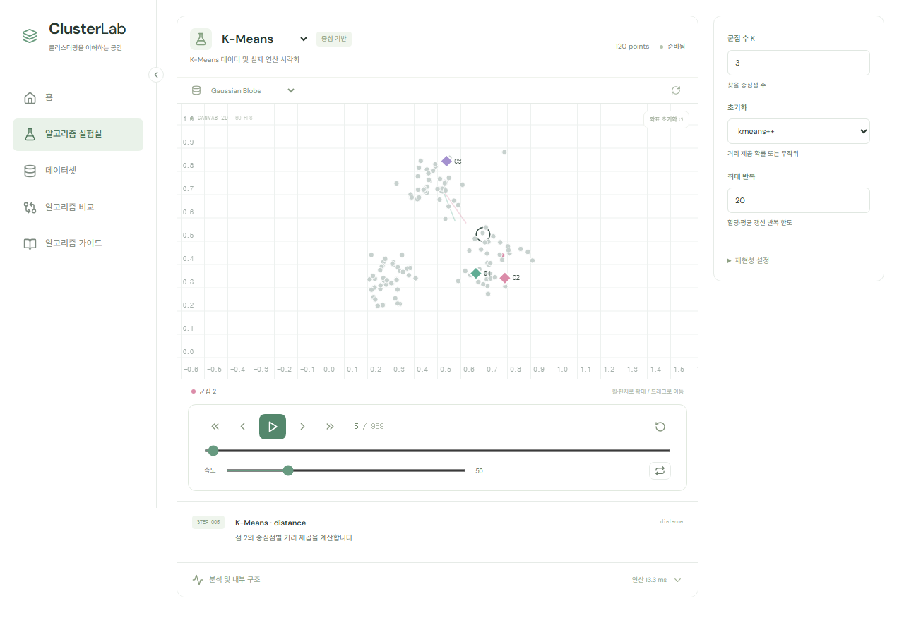
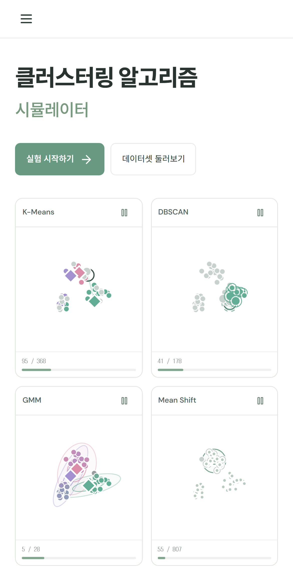
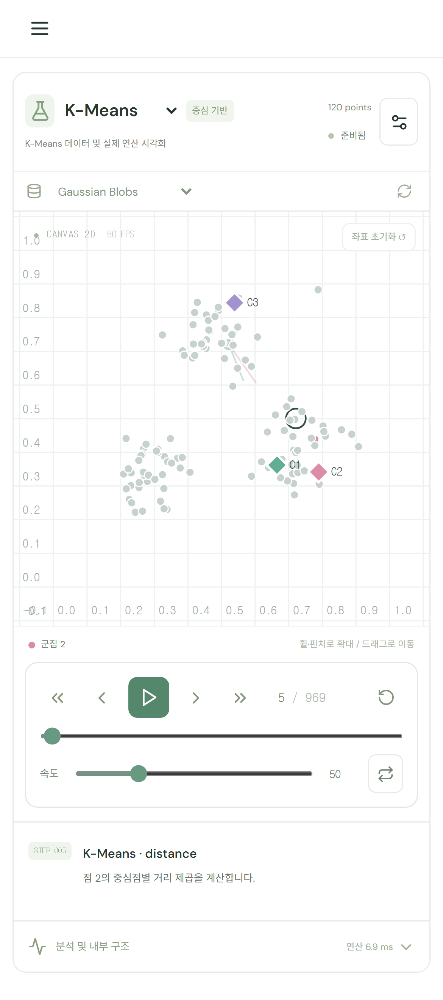

# ClusterLab v0.2 검증 보고서

검증일: 2026-10-29 (Asia/Seoul). v0.2 소스로 프로덕션 번들을 다시 만들고 모든 수치·브라우저 검사와 성능 측정을 새로 실행했습니다. 아래 수치는 v0.1에서 가져온 값이 아닙니다. 이전 기록과 스크린샷은 [v0.1 보관본](v0.1/VALIDATION.md)으로 분리했습니다.

## 구현

- 홈은 **클러스터링 알고리즘 / 시뮬레이터**와 두 시작 버튼으로 간소화했습니다. 2×2 데모는 K-Means·DBSCAN·GMM·Mean Shift이며, 한 번 생성한 60점 원본 배열을 공유합니다. 개별 Worker가 실제 Trace를 만들고 독립적으로 자동 재생·반복합니다. 각 그래프는 해당 알고리즘과 같은 데이터를 실험실로 엽니다.
- 홈의 홍보 문구·갤러리·하단 설명, 상단 breadcrumb·상태·GitHub 링크, 사이드바 홍보 카드·WORKSPACE·하단 문구를 제거했습니다. 모바일 메뉴와 사이드바 접기/펼치기는 유지합니다.
- 실험실 상단에 선택기·분류·동적 시각화 설명·점 수·상태를 통합하고 데이터셋/재생성은 짧은 아래 줄에 남겼습니다. 중복 제목과 설정 패널의 설명·카드·링크·가이드 이동 버튼은 제거했습니다. 관찰 포인트·차이·정의·논문·공식 자료는 가이드에 통합했습니다.
- 큰 배경은 흰색이며 선택 메뉴의 연한 초록과 군집/분석 색은 유지했습니다. 기존 12개 엔진·32개 프리셋·편집·입출력·비교를 보존했습니다.

## Mean Shift의 수학적 조건

독립 모듈 meanshift.ts에서 flat kernel을 사용합니다. 모든 원본 점을 seed로 하고, 매번 고정된 원본 데이터에서 Bandwidth 반경의 이웃을 찾습니다. 그 이웃 평균으로 이동하며, 거리 ≤ 0.001 × Bandwidth이면 수렴합니다. 반복 한도 도달은 수렴으로 표시하지 않습니다. scikit-learn과 같은 카운터로 최초 갱신 이후 max_iter까지 추가 갱신합니다.

종료 후보는 정확한 좌표 중복을 먼저 정리하고, 마지막 이웃 수와 좌표의 내림차순으로 정렬합니다. 이미 유지한 모드의 Bandwidth 안에 있는 후보를 제거한 후 최근접 모드에 모든 점을 할당합니다. K와 난수 시드를 사용하지 않습니다. 구현 조건은 bin_seeding=False, cluster_all=True입니다.

참고: [scikit-learn MeanShift](https://scikit-learn.org/stable/modules/generated/sklearn.cluster.MeanShift.html), [공식 구현](https://github.com/scikit-learn/scikit-learn/blob/main/sklearn/cluster/_mean_shift.py), [Comaniciu & Meer (2002)](https://doi.org/10.1109/34.1000236).

## 전용 애니메이션 및 Trace

후보 ID를 고정하고 초기 등장 → Bandwidth 원과 이웃 강조 → 평균 표식 → 중심/원의 연속 이동과 경로 → 수렴 또는 한도 종료 → 중복 모드로 이동/페이드 → 최종 군집 색상 전환을 기록합니다. 통합/가지 정리 후에도 인덱스가 아닌 ID로 보간합니다. Mean Shift 이외의 기존 중심 보간 방식은 유지합니다.

Mean Shift에서는 전체 후보 배열을 매 이벤트 복제하는 대신 변경 후보의 before/after만 저장합니다. applyStep으로 정방향·역방향을 복원하고 48 이벤트 간격 스냅샷과 조합합니다. 실제 연산 이벤트와 이동 경로를 생략하지 않습니다.

## 통합 속도와 비표시 데모

속도 1~200 전체에서 배율 2^((speed−50)/18)을 사용하며 별도의 fast 상태/버튼/재생 분기가 없습니다. 속도 변경은 시계 위치를 보존합니다. 상위 값에서는 한 rAF 동안 여러 이벤트를 진행하며 표시를 샘플링합니다. Canvas는 실시간 위치 ref를 읽고, 고속의 전체 UI 갱신은 약 30Hz, 작은 홈 카드의 숫자 UI는 80ms 간격으로 제한합니다. 시간 기반 재생·보간은 그대로입니다.

IntersectionObserver와 document.visibilitychange로 보이지 않는 홈 데모의 Worker·계산·재생·Canvas rAF를 중단합니다. 완료된 Trace는 보존하고 재진입 시 위치를 이어갑니다. 완료 전 취소된 계산은 재진입 시 새로 계산합니다. 실험실을 보지 않을 때는 실험실 Worker도 시작하지 않습니다.

## 새 자동 검증 결과

- ESLint·TypeScript·프로덕션 빌드 통과
- Vitest **101/101** 통과; 실패 0
- scikit-learn 1.9.1 / SciPy 기준 **43개** 모두 일치. 이 중 새 Mean Shift **16개**는 분할뿐 아니라 최종 중심 좌표도 비교합니다.
- Mean Shift의 여러 Bandwidth, 분리 군집, 중복/동일 좌표, 반복 한도, K·시드 독립성, 원본 불변성, 수렴, 최근접 할당, 실제 move 이벤트, 유한수, 스냅샷/되감기, 안정 ID, 반경 보간을 검사합니다.
- Playwright **14/14** 통과; 실패 0, flaky 0, skip 0
- 데스크톱 Chromium과 iPhone 13 크기의 Chromium 터치 에뮬레이션에서 새 홈, 13개 엔진의 재생/일시정지/재개/슬라이더 상단/되감기/종료, 32개 프리셋·편집·파일·비교·가이드를 검사했습니다.
- Worker.prototype.postMessage를 감사해 홈 네 엔진에 전달한 원본 데이터가 정확히 같음을 확인했습니다. 가시 영역 밖에서 네 데모의 위치가 멈추고 Worker가 terminate되는 것을 확인했습니다.
- 새 문구·삭제 문구·흰색 배경·모바일 메뉴·접기/펼치기·Mean Shift 설정과 잘못된 Bandwidth 오류를 검사했습니다.

## 새 성능 측정

로컬 Windows, 프로덕션 번들, 각 2.2초 rAF 간격에서 첫 샘플을 제외했습니다. 모바일은 실제 휴대전화가 아닌 Chromium 에뮬레이션입니다. 모든 기기/입력의 60FPS 보장이 아닙니다.

| 시나리오 | 환경 | 점 수 | 평균 FPS | p95 ms | 최대 ms |
|---|---|---:|---:|---:|---:|
| 홈 4개 동시 | chromium 1280×720 | 60 | 60.0 | 16.70 | 16.80 |
| 실험실 K-Means | chromium 1280×720 | 120 | 60.0 | 16.70 | 16.80 |
| 홈 4개 동시 | mobile 390×664 | 60 | 60.0 | 16.70 | 16.80 |
| 실험실 K-Means | mobile 390×664 | 120 | 60.0 | 16.70 | 16.80 |

시드 42, 120점 기본 파라미터의 새 수치 실행입니다. LVQ는 labeled, ROCK은 categorical 프리셋입니다. 1회 측정이며 JSON 크기는 공유 참조가 있는 실제 힙 점유량과 다릅니다.

| 알고리즘 | 실제 이벤트 | 연산 ms | JSON Trace MB |
|---|---:|---:|---:|
| K-Means | 969 | 5.21 | 0.48 |
| DBSCAN | 358 | 5.15 | 0.69 |
| HDBSCAN | 250 | 13.82 | 1.34 |
| AGNES | 240 | 167.44 | 3.20 |
| DIANA | 84 | 53.65 | 0.04 |
| SOM | 1930 | 29.15 | 3.00 |
| LVQ | 1930 | 10.37 | 1.50 |
| OPTICS | 789 | 8.45 | 2.65 |
| PAM | 708 | 17.71 | 0.19 |
| ROCK | 237 | 49.16 | 0.70 |
| GMM | 32 | 3.42 | 0.27 |
| BIRCH | 525 | 8.57 | 1.06 |
| Mean Shift | 1637 | 22.24 | 4.87 |

## 변경 파일

- src/App.tsx
- src/components/HomeDemos.tsx
- src/components/Canvas.tsx
- src/components/Playback.tsx
- src/components/Settings.tsx
- src/components/Analysis.tsx
- src/v02.css
- src/main.tsx
- src/animation/useExperiment.ts
- src/animation/renderer.ts
- src/engine/algorithms/meanshift.ts
- src/engine/types.ts
- src/engine/run.ts
- src/engine/trace.ts
- src/data/guides.ts
- src/engine/meanshift.test.ts
- src/engine/engine.test.ts
- src/animation/animation.test.ts
- src/engine/reference.test.ts
- src/engine/fixtures/reference.json
- tests/site.spec.ts
- tests/quality.spec.ts
- tests/v02.spec.ts
- playwright.config.ts
- scripts/generate-reference.py
- scripts/write-validation.mjs
- package.json
- package-lock.json
- README.md
- index.html

검증 문서·스크린샷 및 v0.1 보관 파일도 함께 갱신합니다. GitHub Actions는 main 푸시 후 같은 검사와 Pages 배포를 수행합니다. 해당 최종 커밋의 원격 검사·배포 상태와 공개 사이트 검증은 작업 최종 보고 및 GitHub Actions 실행 기록에서 확인합니다.

## 남은 제한

- 2~600점 교육용 범위입니다. Mean Shift의 모든 점 seeding과 전수 이웃 탐색은 O(n²T)이며 대규모 입력에서는 기록량과 계산 비용이 큽니다.
- Mean Shift의 자동 Bandwidth 추정, bin seeding, 다른 커널, cluster_all=False, 공간 인덱스는 구현하지 않았습니다. 수동 양의 Bandwidth, flat kernel, 전체 점 seeding 조건에서 검증했습니다.
- 계산 완료 후 Trace를 전달하는 구조입니다. 점진 Worker 스트리밍·dirty-region 렌더링·새로고침 후 실험 복원은 제공하지 않습니다.
- 기존 HDBSCAN/BIRCH/SOM/CSV 범위 제한은 README에 유지합니다. 실제 iOS/WebKit·Firefox·물리 고주사율 기기·장시간 메모리 누수 부하 검사는 별도입니다.

## v0.2 화면 증거

